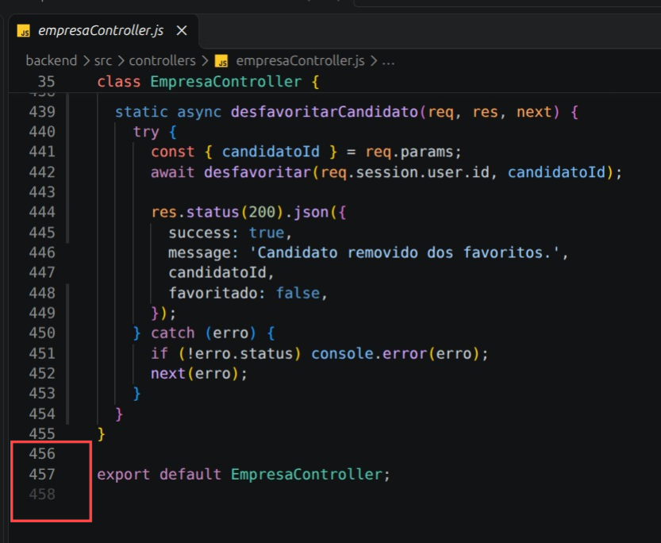
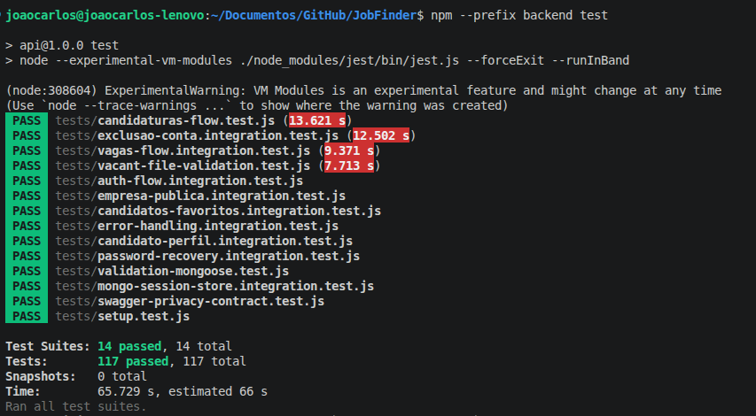

# Relatório de Refatoração — JobFinder

Refatoração em nível de código, aplicada sobre a branch `develop`, com base no catálogo de Martin Fowler e no [capítulo 9 de *Engenharia de Software Moderna*](https://engsoftmoderna.info/cap9.html).

## Visão geral

Este relatório documenta a refatoração em nível de código feita no JobFinder, uma plataforma que conecta candidatos e empresas (cadastro, vagas, candidaturas e banco de talentos). O frontend é em React e o backend em Node.js com Express e MongoDB.

A equipe escolheu quatro tipos de refatoração do catálogo de Martin Fowler e os aplicou ao código do sistema: **Extração de Método**, **Extração de Classe**, **Movimentação de Método** e **Remoção de Código Morto**. Uma quinta tarefa mostra um par de refatorações neutras, **Extração de Método (A)** seguida de **Inline de Método (B)**, em que a segunda desfaz a primeira.

O trabalho foi dividido em cinco issues, cada uma com seu PR, tocando arquivos diferentes para que pudessem andar em paralelo sem conflitos. Todas as mudanças são puras: nenhuma altera o comportamento externo do sistema, o que foi verificado com testes automatizados, comparação do HTML renderizado e demonstração no navegador. As refatorações também estão classificadas como planejadas ou oportunistas, e ligadas aos code smells que resolvem.

O relatório segue esta ordem: resumo das refatorações, justificativas, evidências de antes e depois, refatorações planejadas e oportunistas, code smells, aprendizados e links.

### Issues e PRs

| Issue | PR | Refatoração | Code smell | Tipo |
|-------|----|-------------|-----------|------|
| [#251](https://github.com/JobFinder-Project/JobFinder/issues/251) | [#256](https://github.com/JobFinder-Project/JobFinder/pull/256) | Extração de Método | Método Longo | Planejada + oportunista |
| [#252](https://github.com/JobFinder-Project/JobFinder/issues/252) | [#259](https://github.com/JobFinder-Project/JobFinder/pull/259) | Extração de Classe | Classe Grande (God Class) + Código Duplicado | Planejada + oportunista |
| [#253](https://github.com/JobFinder-Project/JobFinder/issues/253) | [#258](https://github.com/JobFinder-Project/JobFinder/pull/258) | Movimentação de Método | Código Duplicado + Feature Envy | Planejada |
| [#254](https://github.com/JobFinder-Project/JobFinder/issues/254) | [#261](https://github.com/JobFinder-Project/JobFinder/pull/261) | Remoção de Código Morto | Código Morto | Planejada |
| [#255](https://github.com/JobFinder-Project/JobFinder/issues/255) | [#260](https://github.com/JobFinder-Project/JobFinder/pull/260) | Extração de Método (A) → Inline de Método (B) | Método Longo | Neutra (par A/B) |

As quatro primeiras são as refatorações escolhidas do catálogo. A quinta é o par A/B exigido pela atividade. Nenhuma delas é renomeação.

---

## 1. Resumo das refatorações

### 1.1 Extração de Método — `SignupPage` (#251 / PR #256)

**Problema.** `renderStepContent` tinha 191 linhas (171–361) e misturava os campos de conta, de candidato, de empresa e a barra de força da senha. O passo 2 era decidido por seis ternários `isEmployer` (`name`, `label`, `value`, `placeholder`). O `submitForm` copiava 15 campos da empresa um a um.

**O que foi feito.**
- Um método por passo: `renderPassoConta`, `renderPassoPessoal`, `renderPassoProfissional`, `renderPassoExtra`, `renderPassoNegocio` e `renderPassoPerfilEmpresa`.
- `renderStepContent` caiu de 191 para 7 linhas e só escolhe o passo.
- `submitForm` passou a usar `montarPayloadEmpresa` e `montarFormDataCandidato`.
- Separar o passo 2 em `renderPassoPessoal` e `renderPassoNegocio` eliminou os seis ternários.
- **Ajuste vindo da revisão do PR:** `renderPassoPerfilEmpresa` ficou com 64 linhas, acima do alvo de ~50. Foi dividido em `renderDadosInstitucionais` e `renderDescricaoEmpresa`, e `handleTagChange`, que estava duplicado em dois passos, subiu para o nível do componente.

### 1.2 Extração de Classe — `EmpresaController` (#252 / PR #259)

**Problema.** `empresaController.js` tinha 650 linhas e misturava responsabilidades que não são de um controller: validação de bytes de PNG/JPEG/SVG, geração de slug, normalização de campos, busca de candidatos e favoritos. Além disso, `empresaRoutes.js` carregava uma cópia exata da validação de metadados de imagem.

**O que foi feito.** O JavaScript não tem "classe auxiliar" no mesmo sentido do livro, então a extração foi feita em módulos:

| Responsabilidade | Novo módulo |
|------------------|-------------|
| Validação de imagem de vaga (`isAllowedVagaImageMetadata`, `isAllowedVagaImageContent`, assinaturas PNG/JPEG/SVG) | `backend/src/utils/imagemVaga.js` |
| Slug de empresa (`slugifyEmpresaNome`, `gerarSlugUnicoEmpresa`) | `backend/src/services/slugEmpresa.js` |
| Normalização (`escapeRegex`, `normalizeListField`, `normalizeAnoFundacao`) | `backend/src/utils/normalizacao.js` |
| Busca de candidatos e favoritos (`buscarCandidatos`, `listarFavoritos`, `favoritar`, `desfavoritar`) | `backend/src/services/candidatosEmpresa.js` |

Os métodos estáticos do controller mantêm nome, rota, status HTTP e mensagens de erro. O arquivo passou de **650 para 457 linhas**.

### 1.3 Movimentação de Método — helpers duplicados do frontend (#253 / PR #258)

**Problema.** `getImagemSrc` estava copiada 4 vezes e `parseList` 2 vezes (clones Tipo 1). `isApproved`, `isPending` e `isRejected` só operam sobre o `status` de uma candidatura, mas viviam dentro de uma página (Feature Envy).

**O que foi feito.** Três módulos novos, e todos os componentes passaram a importar deles. Os corpos das funções são idênticos aos originais.

| Função | Antes | Depois |
|--------|-------|--------|
| `getImagemSrc` | `JobCard`, `VagaDetalhesModal`, `CandidateCard`, `GestaoCandidaturasPage` | `utils/imagem.js` |
| `parseList` | `CandidateCard`, `GestaoCandidaturasPage` | `utils/listas.js` |
| `isApproved`, `isPending`, `isRejected` | `MinhasCandidaturasPage` | `utils/candidaturaStatus.js` |

Resultado: **8 arquivos, +24 / −53 linhas**.

### 1.4 Remoção de Código Morto — hooks do frontend (#254 / PR #261)

**Problema.** `useCandidato`, `useEmpresa`, `useVagas` e o `hooks/index.js` (~350 linhas) não eram importados por nenhuma página, componente ou teste. Já tinham divergido dos serviços: `useEmpresa` chamava `empresaService.atualizarPerfil(empresaId, dados)`, mas o serviço espera `atualizarPerfil(dados)`. Quem reaproveitasse o hook enviaria o parâmetro errado.

**O que foi feito.** Os 4 arquivos e a pasta `frontend/src/hooks/` foram removidos (**5 arquivos, +11 / −359 linhas**). O código continua no histórico do git. A `frontend/ARCHITECTURE.md` foi atualizada: saiu a pasta `hooks/` e o `useAuth.js` inexistente que ela citava, entraram `contexts/` e `features/vagas/useVagasQuery.js`.

### 1.5 Par A/B neutro — `authController` (#255 / PR #260)

Em `enviarRecuperarSenha`:
- **A (Extração de Método, commit `46bd6b90`):** o objeto `mailOptions` virou `montarEmailRecuperacao(destinatario, linkReset)`.
- **B (Inline de Método, commit `c20e6ee3`):** a função foi trazida de volta para dentro de `enviarRecuperarSenha` e removida.

O resultado líquido é **zero**: `git diff 6f5a8911 c20e6ee3 -- backend/src/controllers/authController.js` não tem saída.

---

## 2. Justificativas das escolhas

| Decisão | Justificativa |
|---------|---------------|
| `renderStepContent` como alvo da Extração de Método | É o maior método do projeto (191 linhas) e o componente já tem teste (`SignupPage.usabilidade.test.jsx`) que protege a refatoração. |
| Dividir o passo 2 em `Pessoal` e `Negocio` | Era a forma de eliminar os ternários `isEmployer` em vez de apenas mover código. A extração passou a remover complexidade, não só linhas. |
| Dividir `renderPassoPerfilEmpresa` (64 linhas) | O critério de aceite pedia métodos abaixo de ~50 linhas. O PR apontou o excesso e a revisão pediu a divisão. Os fragmentos (`<>...</>`) não geram nós no DOM, então o HTML não muda. |
| Módulos em vez de classes no `EmpresaController` | Em JavaScript, funções puras em `utils/` e funções com acesso a banco em `services/` são o equivalente idiomático da Extração de Classe. |
| Extrair também `candidatosEmpresa` | Só as três extrações iniciais deixavam o controller em 558 linhas, acima do critério de ~500. Busca e favoritos eram a maior fatia coesa que restava, e saiu de dentro dos métodos estáticos. |
| **Não** reaproveitar `normalizeListField` no `candidatoController` | O limite de 12 itens mudaria o comportamento. Isso não seria refatoração. |
| **Não** unificar as regras de status entre `GestaoCandidaturasPage` e `MinhasCandidaturasPage` | Uma compara o status exato (`'Pendente'`) e a outra aceita variações em minúsculas. Unificar mudaria o comportamento. |
| Remover os hooks em vez de corrigi-los | Ninguém os usava. Corrigir código que não roda só aumenta o custo de manutenção. O histórico do git preserva o código. |
| Fazer um commit por passo (baby steps) | Permite rodar os testes a cada passo e, no par A/B, comprovar a neutralidade pelo diff entre os commits. |
| Nenhuma renomeação | Renomeação foi excluída da escolha para evitar conflitos entre as cinco frentes de trabalho em paralelo. |

---

## 3. Evidências de antes e depois

### 3.1 Extração de Método — `SignupPage`

**Antes** ([`b5450d86`](https://github.com/JobFinder-Project/JobFinder/blob/b5450d86/frontend/src/pages/Signup/SignupPage.jsx#L171)):

```jsx
const renderStepContent = () => {      // linhas 171–361 (191 linhas)
    if (currentStep === 1) {
        const senhaForca = calcularForcaSenha(formData.senha);
        return ( /* ~30 linhas de JSX */ );
    }
    if (currentStep === 2) { /* ~24 linhas, cheias de ternários isEmployer */ }
    if (currentStep === 3) {
        if (isEmployer) { /* ~56 linhas */ } else { /* ~17 linhas */ }
    }
    if (currentStep === 4 && !isEmployer) { /* ~29 linhas */ }
};

// passo 2: um só bloco decidia tudo por isEmployer
<label htmlFor="signup-field-5">{isEmployer ? 'CNPJ *' : 'CPF *'}</label>
<input id="signup-field-5" name={isEmployer ? "cnpj" : "cpf"}
       value={isEmployer ? formData.cnpj : formData.cpf}
       placeholder={isEmployer ? "00.000.000/0000-00" : "000.000.000-00"} />
```

**Depois** ([`6ecb09fe`](https://github.com/JobFinder-Project/JobFinder/blob/6ecb09fe/frontend/src/pages/Signup/SignupPage.jsx#L353)):

```jsx
const renderStepContent = () => {      // 7 linhas
    const passosCandidato = [renderPassoConta, renderPassoPessoal, renderPassoProfissional, renderPassoExtra];
    const passosEmpresa = [renderPassoConta, renderPassoNegocio, renderPassoPerfilEmpresa];

    const renderPasso = (isEmployer ? passosEmpresa : passosCandidato)[currentStep - 1];
    return renderPasso ? renderPasso() : null;
};

// renderPassoNegocio: sem ternário
<label htmlFor="signup-field-5">CNPJ *</label>
<input id="signup-field-5" name="cnpj" value={formData.cnpj} placeholder="00.000.000/0000-00" />
```

`submitForm` — antes: 15 campos copiados dentro do `if (isEmployer)`. Depois ([`SignupPage.jsx`](https://github.com/JobFinder-Project/JobFinder/blob/6ecb09fe/frontend/src/pages/Signup/SignupPage.jsx#L95-L131)):

```jsx
await empresaService.cadastrar(montarPayloadEmpresa(formData));
// ...
await candidatoService.cadastrar(montarFormDataCandidato(formData));
```

**Medidas**: `renderStepContent` 191 → 7 linhas; seis ternários removidos; todos os métodos `renderPasso*` abaixo de 50 linhas.

```bash
awk '/^    const (renderPasso[A-Za-z]*|renderDadosInstitucionais|renderDescricaoEmpresa|renderStepContent|handleTagChange) = /{n=$2;s=NR} n&&/^    (\};|\);)$/{print n, NR-s+1; n=""}' frontend/src/pages/Signup/SignupPage.jsx

renderPassoConta 34
renderPassoPessoal 22
renderPassoProfissional 19
renderPassoExtra 37
renderPassoNegocio 12
renderPassoPerfilEmpresa 64
renderStepContent 7
```


**Prova de que o comportamento não mudou**:
- `innerHTML` renderizado em **9 estados** (passos 1–4 do candidato e 1–3 da empresa, com senha digitada e máscaras aplicadas) comparado antes e depois: `50907` bytes nos dois, `diff` sem saída. Isso cobre ids, labels, classes e os `aria-describedby`/`aria-invalid`.
- `npm --prefix frontend test`: 22 arquivos, **120 testes** passando, antes e depois, com os testes inalterados.
- Cadastro real de um candidato (4 passos) e de uma empresa (3 passos) no navegador, com backend e MongoDB locais.

📸 **Evidência:**

**Testes e build**: `npm --prefix frontend test` e `npm --prefix frontend run build`.


https://private-user-images.githubusercontent.com/160617063/672713138-1b84d710-c31e-4437-9343-922eb97f6d37.mp4?jwt=eyJ0eXAiOiJKV1QiLCJhbGciOiJIUzI1NiJ9.eyJpc3MiOiJnaXRodWIuY29tIiwiYXVkIjoicmF3LmdpdGh1YnVzZXJjb250ZW50LmNvbSIsImtleSI6ImtleTUiLCJleHAiOjE3OTE5OTI5ODAsIm5iZiI6MTc5MTk5MjY4MCwicGF0aCI6Ii8xNjA2MTcwNjMvNjcyNzEzMTM4LTFiODRkNzEwLWMzMWUtNDQzNy05MzQzLTkyMmViOTdmNmQzNy5tcDQ_WC1BbXotQWxnb3JpdGhtPUFXUzQtSE1BQy1TSEEyNTYmWC1BbXotQ3JlZGVudGlhbD1BS0lBVkNPRFlMU0E1M1BRSzRaQSUyRjIwMjYxMDE0JTJGdXMtZWFzdC0xJTJGczMlMkZhd3M0X3JlcXVlc3QmWC1BbXotRGF0ZT0yMDI2MTAxNFQxNTQ0NDBaJlgtQW16LUV4cGlyZXM9MzAwJlgtQW16LVNpZ25hdHVyZT04OTg3NDU1Yjc0YzVlYzM0NmI4NmE2Y2JjNGFjZjUzY2FmMjYwMjA4YjRhMmY3MTNjZjNhOTAwYjlkYTc1MmE3JlgtQW16LVNpZ25lZEhlYWRlcnM9aG9zdCZyZXNwb25zZS1jb250ZW50LXR5cGU9dmlkZW8lMkZtcDQifQ.d5JayB1mrcNW_6_nlowd5jDCjA4E-OU4brVDnhiDagQ


### 3.2 Extração de Classe — `EmpresaController`

**Antes** ([`b5450d86`](https://github.com/JobFinder-Project/JobFinder/blob/b5450d86/backend/src/controllers/empresaController.js#L25), 650 linhas):

```js
// empresaController.js — topo do arquivo, funções de infraestrutura dentro do controller
const allowedImageExtensionsByMimeType = { 'image/svg+xml': ['.svg'], 'image/png': ['.png'], /* ... */ };
const isAllowedVagaImageMetadata = (file) => { /* ... */ };
const hasPngSignature = (buffer) => /* ... */;
const hasJpegSignature = (buffer) => /* ... */;
const hasSvgSignature = (buffer) => { /* ... */ };
const isAllowedVagaImageContent = (file) => { /* ... */ };
const escapeRegex = (value) => /* ... */;
const slugifyEmpresaNome = (nome) => { /* ... */ };
const gerarSlugUnicoEmpresa = async (nome, empresaId) => { /* ... */ };
const normalizeListField = (value) => { /* ... */ };
const normalizeAnoFundacao = (value) => { /* ... */ };

// routes/empresaRoutes.js (linhas 9–21): cópia idêntica
const allowedImageExtensionsByMimeType = { 'image/svg+xml': ['.svg'], 'image/png': ['.png'], /* ... */ };
const isAllowedVagaImageMetadata = (file) => { /* ... */ };
```

**Depois** ([`empresaController.js`](https://github.com/JobFinder-Project/JobFinder/blob/6ecb09fe/backend/src/controllers/empresaController.js#L1-L30), 457 linhas):

```js
import { isAllowedVagaImageMetadata, isAllowedVagaImageContent } from '../utils/imagemVaga.js';
import {
  buscarCandidatos,
  listarFavoritos,
  favoritar,
  desfavoritar,
} from '../services/candidatosEmpresa.js';
import { gerarSlugUnicoEmpresa } from '../services/slugEmpresa.js';
import { normalizeListField, normalizeAnoFundacao } from '../utils/normalizacao.js';
```

[`routes/empresaRoutes.js`](https://github.com/JobFinder-Project/JobFinder/blob/6ecb09fe/backend/src/routes/empresaRoutes.js#L5) — cópia removida:

```js
import { isAllowedVagaImageMetadata } from '../utils/imagemVaga.js';
```

Método do controller depois de extrair a busca (`buscarCandidatos` perdeu a validação e a consulta, ~100 linhas):

```js
static async buscarCandidatos(req, res, next) {
  try {
    const { q, vagaId } = req.query;
    const candidatos = await buscarCandidatos(req.session.user.id, { q, vagaId });
    // ... resposta idêntica
```

**Medidas:** `empresaController.js` 650 → 457 linhas; `empresaRoutes.js` −15 linhas / +1; 4 módulos novos.



**Testes**: `npm --prefix backend test` com 117 de 117 passando após as três primeiras extrações; ESLint limpo nos arquivos alterados. A extração de `candidatosEmpresa` veio depois, no commit [`3b3831b9`](https://github.com/JobFinder-Project/JobFinder/commit/3b3831b9).



### 3.3 Movimentação de Método — helpers do frontend

**Antes** (o mesmo trecho em 4 arquivos: `JobCard.jsx:9`, `VagaDetalhesModal.jsx:75`, `CandidateCard.jsx:17`, `GestaoCandidaturasPage.jsx:77`):

```jsx
const getImagemSrc = (imagem) => {
    if (!imagem) return null;
    if (typeof imagem === 'string') return imagem;
    if (imagem.data && imagem.contentType) {
        return `data:${imagem.contentType};base64,${imagem.data}`;
    }
    return null;
};

// MinhasCandidaturasPage.jsx:34-36 — lógica de status dentro da página
const isApproved = (s) => ['aceito', 'aceita', 'aprovado', 'aprovada'].includes(s?.toLowerCase());
const isPending  = (s) => s?.toLowerCase().includes('pendente');
const isRejected = (s) => ['rejeitado', 'rejeitada', 'cancelado', 'cancelada'].includes(s?.toLowerCase());
```

**Depois** ([`utils/imagem.js`](https://github.com/JobFinder-Project/JobFinder/blob/6ecb09fe/frontend/src/utils/imagem.js), [`utils/candidaturaStatus.js`](https://github.com/JobFinder-Project/JobFinder/blob/6ecb09fe/frontend/src/utils/candidaturaStatus.js)):

```jsx
// utils/imagem.js — única definição
export const getImagemSrc = (imagem) => { /* corpo idêntico */ };

// utils/candidaturaStatus.js
export const isApproved = (s) => ['aceito', 'aceita', 'aprovado', 'aprovada'].includes(s?.toLowerCase());
export const isPending = (s) => s?.toLowerCase().includes('pendente');
export const isRejected = (s) => ['rejeitado', 'rejeitada', 'cancelado', 'cancelada'].includes(s?.toLowerCase());

// JobCard.jsx e os demais componentes
import { getImagemSrc } from '../../utils/imagem';
```

**Medidas:** 4 cópias de `getImagemSrc` → 1; 2 cópias de `parseList` → 1; 8 arquivos, +24 / −53 linhas. Testes: 22 arquivos / 120 testes, iguais antes e depois, e `npm --prefix frontend run build` sem erros.

https://private-user-images.githubusercontent.com/160617063/672687746-d3ee8508-c758-42ae-a6a8-177625a7e78d.mp4?jwt=eyJ0eXAiOiJKV1QiLCJhbGciOiJIUzI1NiJ9.eyJpc3MiOiJnaXRodWIuY29tIiwiYXVkIjoicmF3LmdpdGh1YnVzZXJjb250ZW50LmNvbSIsImtleSI6ImtleTUiLCJleHAiOjE3OTE5OTMzMDYsIm5iZiI6MTc5MTk5MzAwNiwicGF0aCI6Ii8xNjA2MTcwNjMvNjcyNjg3NzQ2LWQzZWU4NTA4LWM3NTgtNDJhZS1hNmE4LTE3NzYyNWE3ZTc4ZC5tcDQ_WC1BbXotQWxnb3JpdGhtPUFXUzQtSE1BQy1TSEEyNTYmWC1BbXotQ3JlZGVudGlhbD1BS0lBVkNPRFlMU0E1M1BRSzRaQSUyRjIwMjYxMDE0JTJGdXMtZWFzdC0xJTJGczMlMkZhd3M0X3JlcXVlc3QmWC1BbXotRGF0ZT0yMDI2MTAxNFQxNTUwMDZaJlgtQW16LUV4cGlyZXM9MzAwJlgtQW16LVNpZ25hdHVyZT1iNTUwNmY2MGNiZjhjZjQ3Y2JiNmEyZTY4MGZlMWRhODIzOTZhNjE3Y2UzOWZjOGY1YmNmNTcxOTY4ZWEyMmIzJlgtQW16LVNpZ25lZEhlYWRlcnM9aG9zdCZyZXNwb25zZS1jb250ZW50LXR5cGU9dmlkZW8lMkZtcDQifQ.Es0oyeWtO8nv8tsmhlIESAi7M9hH3JHVXojJeFfPVlQ

### 3.4 Remoção de Código Morto — hooks

**Antes** ([`b5450d86`](https://github.com/JobFinder-Project/JobFinder/tree/b5450d86/frontend/src/hooks)):

```js
// hooks/useEmpresa.js — chama o serviço com a assinatura antiga
const atualizarPerfil = useCallback(async (empresaId, dados) => {
    setLoading(true); setError(null)
    try {
      const data = await empresaService.atualizarPerfil(empresaId, dados)   // serviço: atualizarPerfil(dados)
      ...

// hooks/index.js
export { useAuth } from '../contexts/AuthContext'
export { useCandidato } from './useCandidato'
export { useEmpresa } from './useEmpresa'
export { useVagas } from './useVagas'
```

**Depois:** a pasta `frontend/src/hooks/` não existe mais. `git show --stat 5eef0f26`:

```
 frontend/ARCHITECTURE.md           |  19 +++---
 frontend/src/hooks/index.js        |   5 --
 frontend/src/hooks/useCandidato.js | 136 ----
 frontend/src/hooks/useEmpresa.js   | 131 ----
 frontend/src/hooks/useVagas.js     |  79 ---
 5 files changed, 11 insertions(+), 359 deletions(-)
```

**Verificação:** `grep -rn "useCandidato\|useEmpresa\|useVagas\b" frontend/src` não retorna nada depois da remoção. O PR #261 também traz dois vídeos de navegação (candidato e empregador) mostrando o sistema sem diferença.

### 👤 Candidato
Login → dashboard → busca de vagas → detalhes da vaga → candidatar-se → minhas candidaturasl

https://github.com/user-attachments/assets/6ce5b1a5-3f39-4bd3-9007-0c173821396a

### 🏢 Empregador
Login → dashboard → gerenciar vagas → gestão de candidaturas (candidato aparece em "Novos / Pendentes") → aprovar candidatura

https://github.com/user-attachments/assets/09768184-1d2c-4cef-a23d-c61e0f82211c

### 3.5 Par A/B — `authController`

**Estado original** (`6f5a8911`):

```js
const frontendUrl = req.get('origin') || `${req.protocol}://${req.get('host')}`;
const linkReset = `${frontendUrl.replace(/\/$/, '')}/redefinir-senha/${token}`;

const mailOptions = {
  from: process.env.APP_EMAIL,
  to: req.body.email,
  subject: 'Recuperar senha - App JobFinder',
  html: `
          <h1>Recuperar Senha</h1>
          <p>Para recuperar sua senha, acesse o link abaixo:</p>
          <a href='${linkReset}'>${linkReset}</a>
          <p>Este link expira em 15 minutos.</p>
          <p>Se você não solicitou isso, ignore este e-mail.</p>
          `,
};

await transporter.sendMail(mailOptions);
```

**Refatoração A — Extração de Método** (commit [`46bd6b90`](https://github.com/JobFinder-Project/JobFinder/commit/46bd6b90), `+14 / −12`):

```js
const montarEmailRecuperacao = (destinatario, linkReset) => ({
  from: process.env.APP_EMAIL,
  to: destinatario,
  subject: 'Recuperar senha - App JobFinder',
  html: `
          <h1>Recuperar Senha</h1>
          ...
          `,
});

// em enviarRecuperarSenha:
const mailOptions = montarEmailRecuperacao(req.body.email, linkReset);
await transporter.sendMail(mailOptions);
```

**Refatoração B — Inline de Método** (commit [`c20e6ee3`](https://github.com/JobFinder-Project/JobFinder/commit/c20e6ee3), `+12 / −14`): `montarEmailRecuperacao` é removida e o `mailOptions` volta para dentro de `enviarRecuperarSenha`, idêntico ao original.

**Prova de neutralidade:**

```
$ git diff 6f5a8911 c20e6ee3 -- backend/src/controllers/authController.js
(sem saída)
```

`password-recovery.integration.test.js` passou (4 de 4) no estado original, após A e após B. A suíte completa do backend passou com 12 suítes e 107 testes.

**Testes nos três estados:**

```console
=== 6f5a8911 (original)
Test Suites: 1 passed, 1 total
Tests:       4 passed, 4 total
=== 46bd6b90 (após A)
Test Suites: 1 passed, 1 total
Tests:       4 passed, 4 total
=== c20e6ee3 (após B)
Test Suites: 1 passed, 1 total
Tests:       4 passed, 4 total
```

**Execução completa dos testes backend:**


**Fluxo de redefinição de senha permanece:**

https://github.com/user-attachments/assets/a523557e-b47d-4a09-970c-e040cf8435d9

---

## 4. Refatorações planejadas e oportunistas

**Planejadas** (antecipadas e estruturadas; cada uma nasceu de uma issue escrita antes do código, com arquivos, critérios de aceite e smells definidos):

| Refatoração | Issue |
|-------------|-------|
| Um método por passo no `SignupPage` | #251 |
| Extração de `imagemVaga`, `slugEmpresa` e `normalizacao` do `EmpresaController` | #252 |
| Movimentação de `getImagemSrc`, `parseList` e dos predicados de status | #253 |
| Remoção dos hooks mortos | #254 |
| Par A/B em `enviarRecuperarSenha` | #255 |

**Oportunistas** (feitas porque a equipe já estava no código, sem planejamento prévio):

| Refatoração | Como surgiu | Evidência |
|-------------|-------------|-----------|
| `formatPhone` movida para `utils/formatters.js` junto com `formatCPF` e `formatCNPJ` | Ao mexer nas funções de formatação durante a extração dos passos do cadastro, notou-se que `formatPhone` existia idêntica em `SignupPage.jsx` e `PerfilEmpresaModal.jsx`. | Commit [`ef8680d4`](https://github.com/JobFinder-Project/JobFinder/commit/ef8680d4) (declara "refatoração oportunista") |
| Remoção da cópia da validação de imagem em `empresaRoutes.js` | Ao extrair `imagemVaga.js`, a rota continha uma cópia exata de `allowedImageExtensionsByMimeType` e `isAllowedVagaImageMetadata`. | Commit [`12b1726a`](https://github.com/JobFinder-Project/JobFinder/commit/12b1726a) |
| `handleTagChange` unificado e `renderPassoPerfilEmpresa` dividido | Surgiram na revisão do PR #256, ao reler o código dos passos. | Commit [`2bca63ee`](https://github.com/JobFinder-Project/JobFinder/commit/2bca63ee) |
| `frontend/ARCHITECTURE.md` corrigida | Ao remover os hooks, notou-se que o documento citava `hooks/` e um `useAuth.js` inexistentes. | Commit [`5eef0f26`](https://github.com/JobFinder-Project/JobFinder/commit/5eef0f26) |

---

## 5. Code smells identificados

| Code smell | Onde | Por que é smell | Como a refatoração resolveu ou mitigou |
|------------|------|-----------------|----------------------------------------|
| **Método Longo** | `renderStepContent` (191 linhas) | Mistura vários níveis de abstração e é difícil de ler e alterar sem quebrar outro passo. | Extração de Método: 7 linhas, um método por passo, seis ternários eliminados. |
| **Método Longo** | `enviarRecuperarSenha` (~50 linhas) | Mistura busca de usuário, token, HTML e envio. | A mitiga, e a B mostra que a organização é independente do comportamento. |
| **Classe Grande (God Class)** | `EmpresaController` (650 linhas) | Cuidava de cadastro, vagas, candidaturas, busca e favoritos, e ainda carregava validação de bytes e slug. | Extração de Classe: 650 → 457 linhas, quatro módulos coesos. |
| **Código Duplicado** | `formatPhone` (2×), validação de imagem de vaga (2×), `getImagemSrc` (4×), `parseList` (2×) | Uma correção precisa ser lembrada em todos os lugares. Por exemplo, suportar `image/webp` exigiria alterar 4 arquivos. | Cada função tem agora uma única definição. |
| **Feature Envy** | `isApproved`, `isPending`, `isRejected` em `MinhasCandidaturasPage` | Só operam sobre o `status` de uma candidatura, mas viviam dentro da tela. | Movimentação de Método para `utils/candidaturaStatus.js`. |
| **Código Morto** | `hooks/*` (~350 linhas) | É lido e mantido sem ser executado, e já tinha divergido do serviço (`atualizarPerfil`). Repetia o mesmo bloco `setLoading / try / catch / finally`. | Remoção de Código Morto. |
